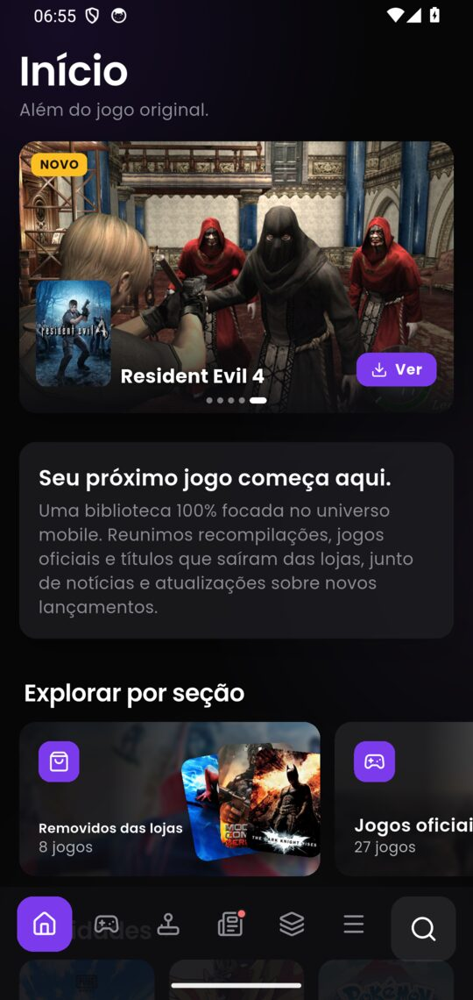
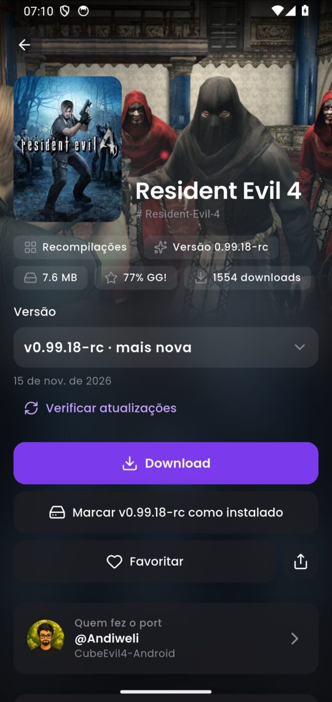
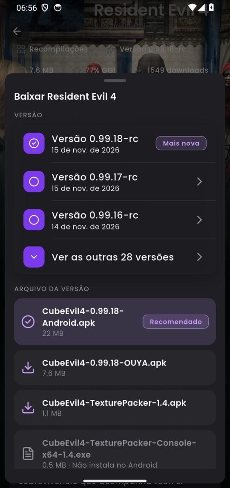
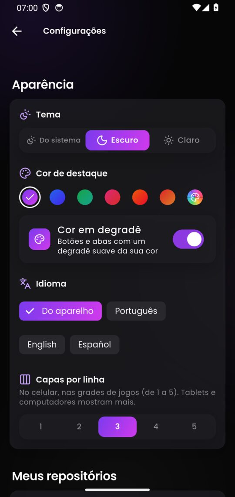
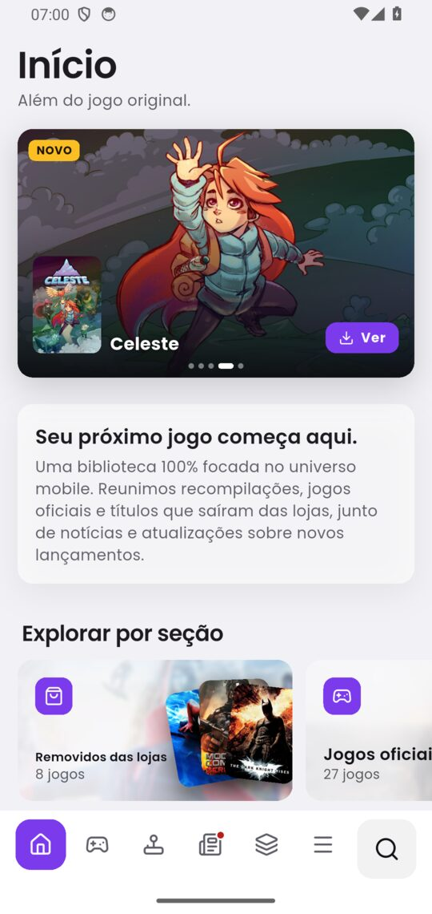
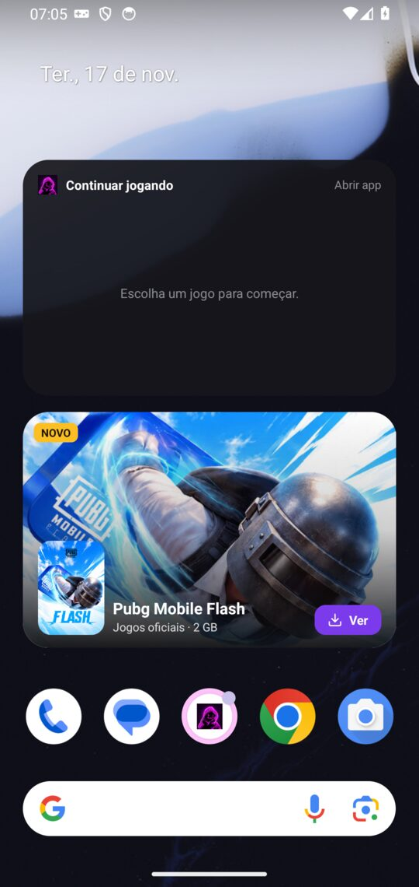
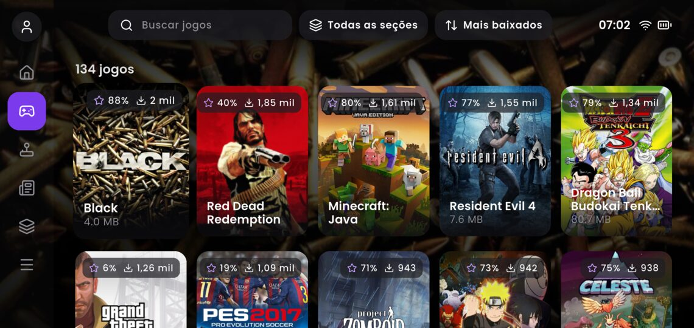
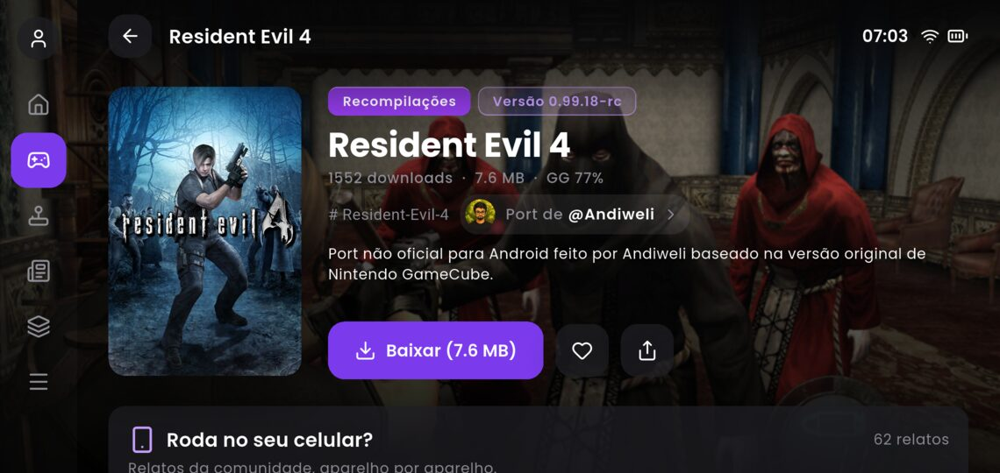
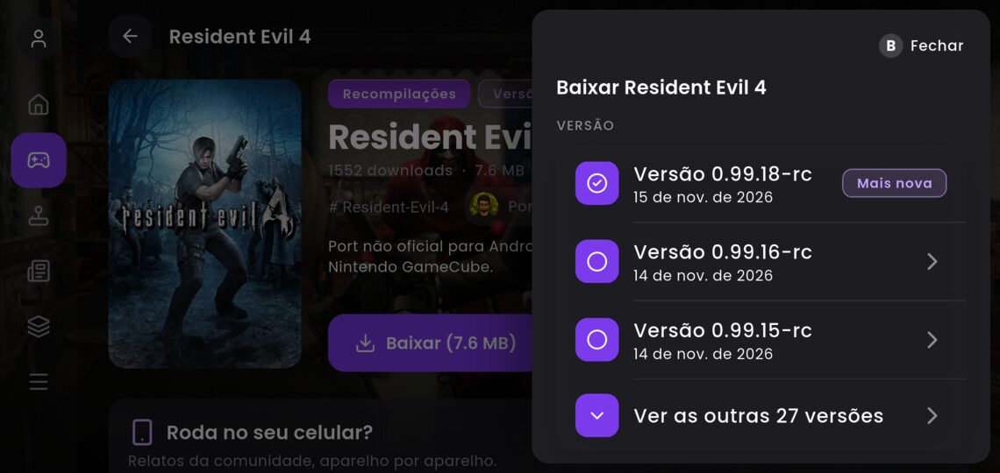
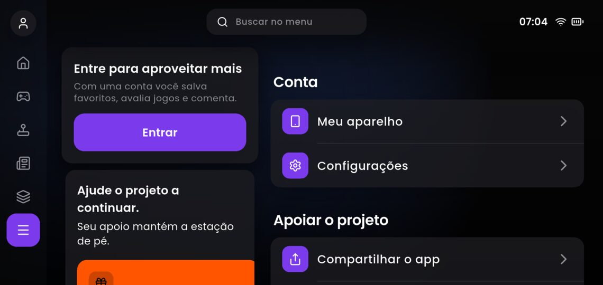

# Station-Z

**Além do jogo original.**

Recompilações, ports e jogos que saíram das lojas, num só lugar no seu Android.

 

&nbsp;

&nbsp;

---

## 📸 Telas

<table>
  <tr>
    <td></td>
    <td></td>
    <td></td>
  </tr>
  <tr>
    <td align="center">Início</td>
    <td align="center">Página do jogo</td>
    <td align="center">Escolha a versão e o arquivo</td>
  </tr>
  <tr>
    <td></td>
    <td></td>
    <td></td>
  </tr>
  <tr>
    <td align="center">Sua cor, com degradê</td>
    <td align="center">Tema claro</td>
    <td align="center">Widgets na tela inicial</td>
  </tr>
</table>

**Celular deitado (modo console, com controle):**

<table>
  <tr>
    <td></td>
    <td></td>
  </tr>
  <tr>
    <td></td>
    <td></td>
  </tr>
</table>

## 📖 Sobre

O **Station-Z** é uma biblioteca de jogos para Android: recompilações nativas, ports de PC e de consoles, jogos oficiais e títulos que saíram das lojas, todos organizados num só app.

Cada jogo traz versão, tamanho, novidades de cada atualização e relatos de quem já jogou ("roda no meu celular?"), para você saber o que esperar antes de baixar. Junto com o catálogo, o app tem notícias e uma comunidade para conversar sobre os jogos.

## ✨ O que o app tem

- 🕹️ **Modo console:** vire o celular e o app vira um console, com barra lateral, capas grandes, a arte do jogo ao fundo e janelas no painel lateral.
- 🎮 **Suporte a controle:** navegue pelo app inteiro com o direcional e os botões A, B, X e Y.
- 🕹️ **Emuladores:** uma aba com mais de 30 emuladores (RetroArch, PPSSPP, Dolphin, Azahar, ARMSX2, Eden, Winlator e outros), só com links oficiais.
- 🎮 **Catálogo organizado:** recompilações, jogos oficiais e removidos das lojas, em seções e coleções.
- 🔎 **Busca e filtros:** ache o jogo pelo nome e filtre por seção.
- 📦 **Página do jogo completa:** versão, tamanho, histórico de versões, o que mudou em cada uma e quem fez o port.
- 📂 **Escolha o que baixar:** a versão e o arquivo da release, com o tamanho de cada um e o recomendado marcado.
- ⬇️ **Download dentro do app, sem precisar de conta:** acompanhe o progresso pela notificação e cancele quando quiser.
- 📱 **"Roda no meu celular?":** relatos da comunidade, aparelho por aparelho, com nota de 1 a 5.
- 🔧 **Meu aparelho:** veja o chip, a GPU, a memória e a tela do seu celular.
- ⭐ **Meu Hub:** seus favoritos e os jogos que você instalou.
- 🧩 **Tudo que precisa:** links extras de cada jogo (fanart, vídeos, traduções, mods) pelos repositórios que você escolher.
- 📰 **Notícias e comunidade:** artigos, imagens e enquetes.
- 🔔 **Avisos:** jogo novo, notícias, posts e enquetes, atualização dos seus jogos e versão nova do app.
- 📱 **Widgets na tela inicial:** continuar jogando, novidades, notícias e busca.
- 🆔 **Seu @:** um nome único, a sua identidade no Station-Z.
- 🆕 **Aviso de versão nova:** o app avisa quando sai uma atualização, com as novidades.
- 🎨 **Do seu jeito:** escolha a cor do app (ou qualquer tom), com degradê se quiser.
- 🌓 **Tema escuro e claro**, em português, inglês e espanhol.

## 📲 Como instalar

1. Abra a [versão mais nova](https://github.com/BelmanteGu/stationz-app/releases/latest).
2. Baixe o APK do seu celular:

| Arquivo | Para quem |
|---|---|
| `StationZ-X.Y.Z-universal.apk` | Funciona em qualquer celular. Na dúvida, baixe este. |
| `StationZ-X.Y.Z-arm64.apk` | Celulares dos últimos anos (arquivo menor). |
| `StationZ-X.Y.Z-armv7-32bit.apk` | Celulares antigos, de 32 bits. |

3. Abra o arquivo baixado. Se o Android pedir, permita instalar apps desta fonte.

## 🧩 Crie seu addon

Quer pôr links extras nos jogos (fanart, vídeos, traduções, mods)? Siga o [guia passo a passo para criar um addon](GUIA-ADDON.md).

## 🔄 Como atualizar

O próprio app avisa quando sai uma versão nova. Toque em **Baixar agora** e instale por cima: sua conta, seus favoritos e seus dados continuam.

> **Vindo de uma versão anterior à 0.6.0?** A partir da 0.6.0 o app tem uma assinatura própria, então o Android não deixa instalar por cima das versões antigas. Desinstale a versão antiga e instale a nova; depois é só entrar na conta de novo. Os jogos baixados continuam na pasta Downloads. Isso só acontece uma vez.

## 🛡️ Aviso de antivírus (VirusTotal)

No VirusTotal, 2 de quase 70 antivírus (Google e Ikarus) marcam o APK do Station-Z como "trojan". **É um falso positivo: o app não tem vírus nem trojan.** Os outros antivírus, incluindo Kaspersky, ESET, Avast, Bitdefender e Microsoft, não acusam nada.

O alerta é automático e vem da combinação de coisas que o app faz para funcionar, sempre para você e na sua tela:

- **Instala os jogos que você escolhe baixar**, e só depois de você confirmar no instalador do Android.
- **Vê quais apps estão instalados** para mostrar o botão **Jogar** nos jogos que você já tem.
- **Lê os dados do aparelho** (chip, placa de vídeo, memória e tela) para mostrar na tela **Meu aparelho**. Eles só saem do celular quando você mesmo envia um relato de "roda no meu celular?".

O Station-Z não lê seus contatos, mensagens, fotos, localização nem senhas. Veja também a [política de privacidade](https://stationz-legal.pages.dev/privacidade/).

## ✅ Requisitos

- Android 7.0 ou mais novo.
- Internet para ver o catálogo e baixar os jogos.

## 💜 Apoie o projeto

O Station-Z é gratuito e se mantém com anúncios e com o apoio da comunidade, como o [Live Pix do Znacker](https://livepix.gg/znacker). Para usar sem anúncios, assista aos vídeos de apoio do dia no **Menu › Apoiar o projeto** ou compre o "sem anúncios para sempre" dentro do app.

## 🙌 Créditos

O Station-Z existe graças a estes canais. Siga e apoie:

| Canal | Onde |
|---|---|
| **Znacker** | [YouTube](https://youtube.com/@znacker) · [Instagram](https://www.instagram.com/znacker77/) · [Live Pix](https://livepix.gg/znacker) |
| **Belmante** | [belmante.com.br](https://belmante.com.br/) |

Os jogos, recompilações e ports listados no app pertencem aos seus autores e projetos originais; o Station-Z só organiza e indica onde encontrá-los.

## 🔒 Privacidade

Leia a [política de privacidade](https://stationz-legal.pages.dev/privacidade/), os [termos de uso](https://stationz-legal.pages.dev/termos/) e [como excluir sua conta](https://stationz-legal.pages.dev/excluir-conta/).

---

**Station-Z: além do jogo original.**

Este repositório guarda só os APKs oficiais do app.

